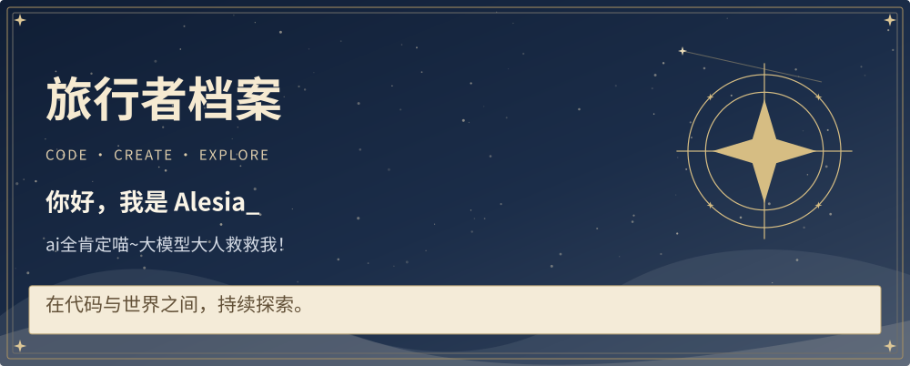
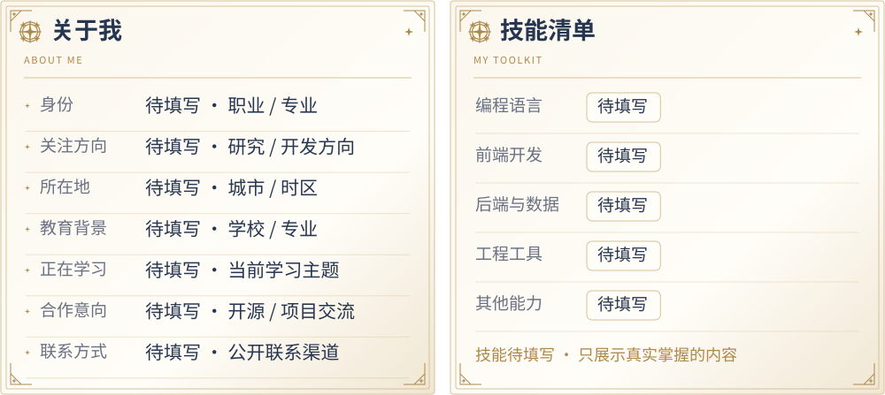
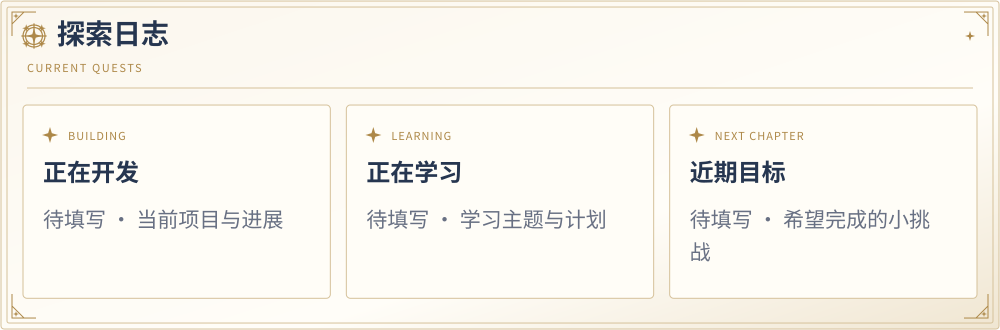
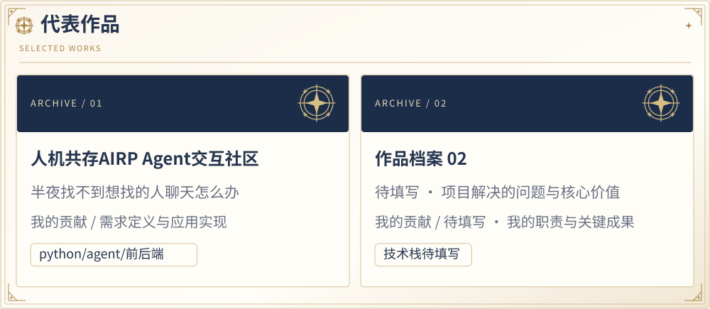
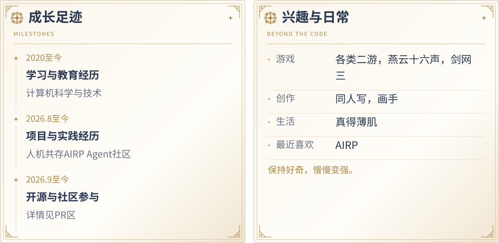
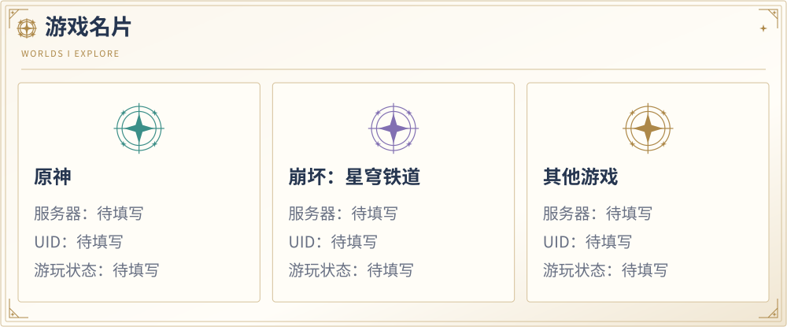
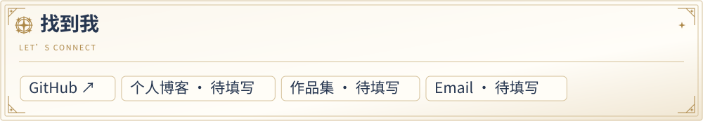

<!-- Generated by scripts/build_profile.py. Edit profile/*.json and profile/modules/*.json instead. -->

<picture>
  <source media="(max-width: 600px)" srcset="assets/generated/hero-mobile.svg">
  
</picture>

<picture>
  <source media="(max-width: 600px)" srcset="assets/generated/row-01-mobile.svg">
  
</picture>

<picture>
  <source media="(max-width: 600px)" srcset="assets/generated/row-02-mobile.svg">
  
</picture>

<picture>
  <source media="(max-width: 600px)" srcset="assets/generated/row-03-mobile.svg">
  
</picture>

<picture>
  <source media="(max-width: 600px)" srcset="assets/generated/row-04-mobile.svg">
  
</picture>

<picture>
  <source media="(max-width: 600px)" srcset="assets/generated/row-05-mobile.svg">
  
</picture>

<picture>
  <source media="(max-width: 600px)" srcset="assets/generated/row-06-mobile.svg">
  
</picture>

<a href="https://github.com/Alesia0411">GitHub ↗</a>

✦ 正在学习，也在冒险 ✦

文字版档案 · 复制 UID / 查看全部信息

Alesia_ · @Alesia0411 ai全肯定喵~大模型大人救救我！

<h3>关于我</h3>
<ul>
<li>身份：硕士在读</li>
<li>关注方向：AI</li>
<li>所在地：无处不在喵</li>
<li>教育背景：HFUT计科</li>
<li>正在学习：AI Agent</li>
<li>合作意向：任何都欢迎喵</li>
<li>联系方式：1151127235@qq.com</li>
</ul>
<h3>技能清单</h3>
<ul>
<li>编程语言：python/C++</li>
<li>前端开发：HTML/Vue</li>
<li>后端与数据：MySQL/FastAPI</li>
<li>工程工具：Docker/Redis</li>
<li>其他能力：agent相关基本都可以喵</li>
<li>欢迎客户点菜喵</li>
</ul>
<h3>探索日志</h3>
<ul>
<li>正在开发：人机共存AIRP Agent交互社区</li>
<li>正在学习：AI Agent， 世界模型</li>
<li>近期目标：学会所有Ai和开发相关技术喵</li>
</ul>
<h3>代表作品</h3>
<ul>
<li>人机共存AIRP Agent交互社区：半夜找不到想找的人聊天怎么办；我的贡献：需求定义与应用实现；技术栈：python/agent/前后端</li>
<li>作品档案 02：待填写 · 项目解决的问题与核心价值；我的贡献：待填写 · 我的职责与关键成果；技术栈：技术栈待填写</li>
</ul>
<h3>成长足迹</h3>
<ul>
<li>2020至今 · 学习与教育经历 — 计算机科学与技术</li>
<li>2026.8至今 · 项目与实践经历 — 人机共存AIRP Agent社区</li>
<li>2026.9至今 · 开源与社区参与 — 详情见PR区</li>
</ul>
<h3>兴趣与日常</h3>
<ul>
<li>游戏：各类二游，燕云十六声，剑网三</li>
<li>创作：同人写，画手</li>
<li>生活：真得薄肌</li>
<li>最近喜欢：AIRP</li>
<li>保持好奇，慢慢变强。</li>
</ul>
<h3>游戏名片</h3>
<ul>
<li>原神｜服务器：官服｜UID：107810124｜游玩状态：在玩</li>
<li>崩坏：星穹铁道｜服务器：官服｜UID：100547580｜游玩状态：在玩</li>
<li>明日方舟｜服务器：官服｜UID：Alesia#9807｜游玩状态：在玩</li>
</ul>
<h3>找到我</h3>
<ul>
<li>GitHub：https://github.com/Alesia0411</li>
<li>个人博客：待填写</li>
<li>作品集：待填写</li>
<li>Email：待填写</li>
</ul>

正在学习，也在冒险

